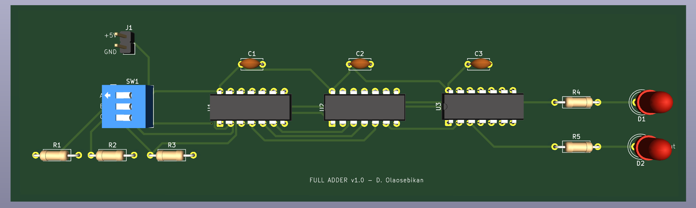

# 1-Bit Full Adder PCB

A 2-layer PCB I designed in KiCad that adds three 1-bit inputs (A, B, Carry-in)
using 74HC-series logic chips. DIP switches set the inputs, and two LEDs show
Sum and Carry-out.

## Design
- 74HC86 (XOR), 74HC08 (AND), 74HC32 (OR) logic ICs
- 10k pull-down resistors on each switch input
- 0.1 µF decoupling capacitor next to each chip
- Unused CMOS gate inputs tied to ground
- Ground pour on the back layer, signal traces on the front

## Files
- `full_adder_pcb.pdf`: schematic
- `full_adder_pcb.kicad_*`: KiCad project files
- `full_adder_gerbers.zip`: Gerber and drill files for fabrication

## Status
- [x] Schematic (passes ERC)
- [x] PCB layout (passes DRC and schematic parity)
- [x] Gerber and drill files generated
- [ ] Fabrication
- [ ] Assembly and testing against the truth table
